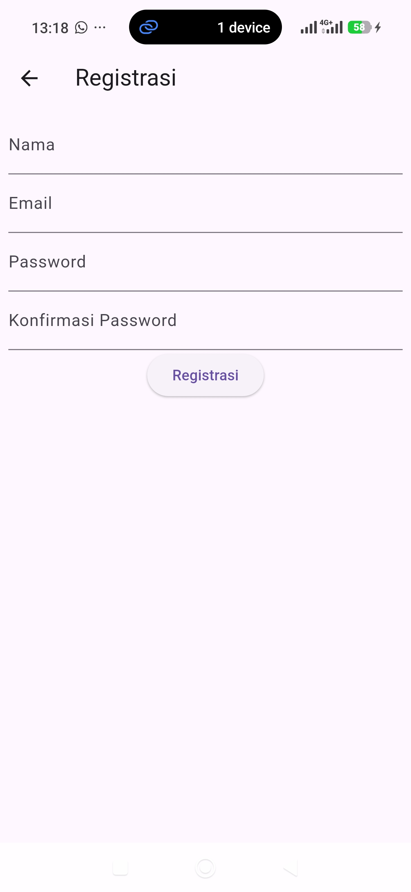
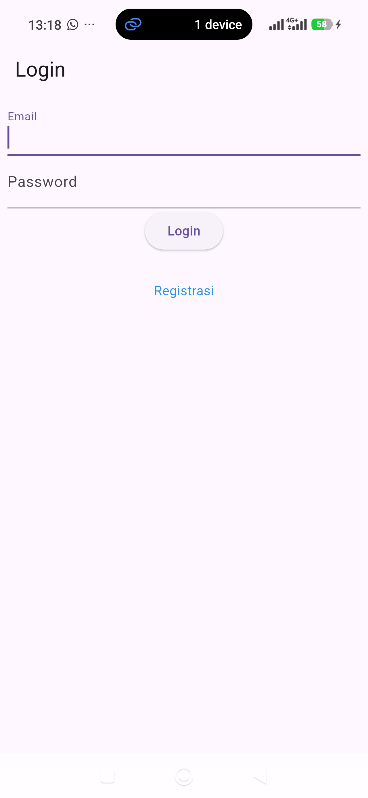
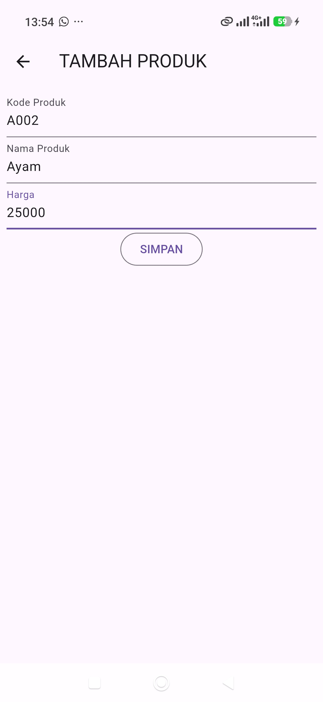
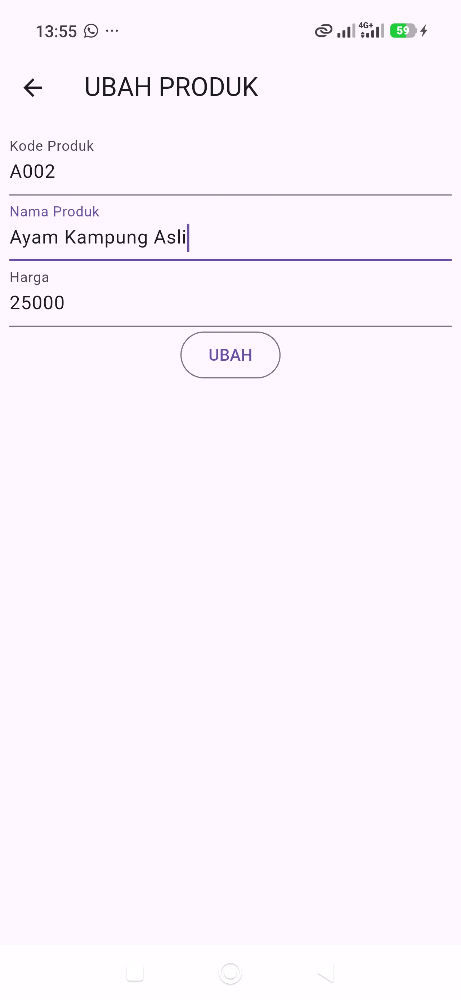
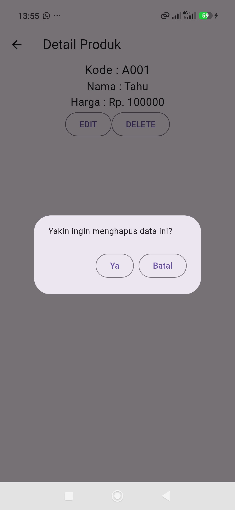

# Praktikum Pemrograman Mobile Menggunakan Flutter

### Nama       : Faqih Ardiansyah  
### NIM        : H1D024047  
### Shift Awal : A  
### Shift Baru : F  
 

## Pertemuan 4 dan 5 - Operasi CRUD dengan API Codeigniter 4 
Pertemuan 1 sampai 3 di repo ini --> [Pertemuan 1-3](https://github.com/faqihardi/H1D024047-Praktikum-Mobile_Flutter)
| Registrasi | Login | Tambah | Home List |
| :---: | :---: | :---: | :---: | 
|  |  |  |  |

| Detail | Edit | Delete | 
| :---: | :---: | :---: | 
|  |  |  | 